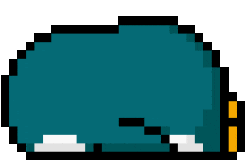
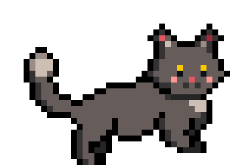
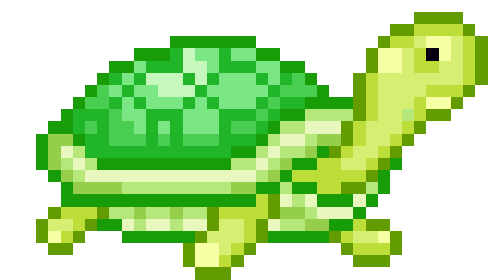
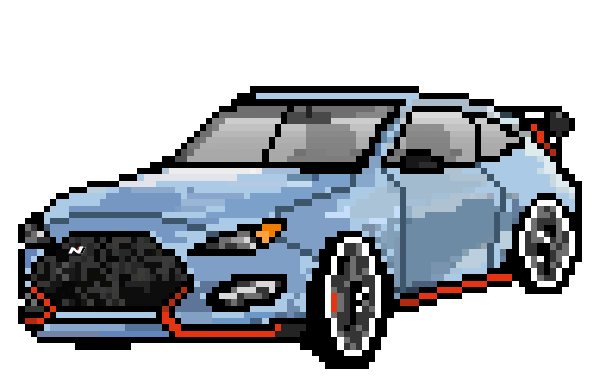

<h2>Hi there, I'm Luana </h2>

<p><em>
  Computer Science Student
    
  </br>
  Aspiring Full-Stack Developer
    
  </br>
  Always learning and building projects
    
</em></p>


### A little more about me... 

```javascript
const luana = {
  pronouns: "she" | "her",
  education: "Computer Science Student",
  learning: ["JavaScript", "React", "C#", "Node.js"],
  tools: ["HTML", "CSS", "Git", "GitHub", "VS Code"],
  goal: "Building awesome projects for my developer portfolio",
  interest: "International tech opportunities"
}